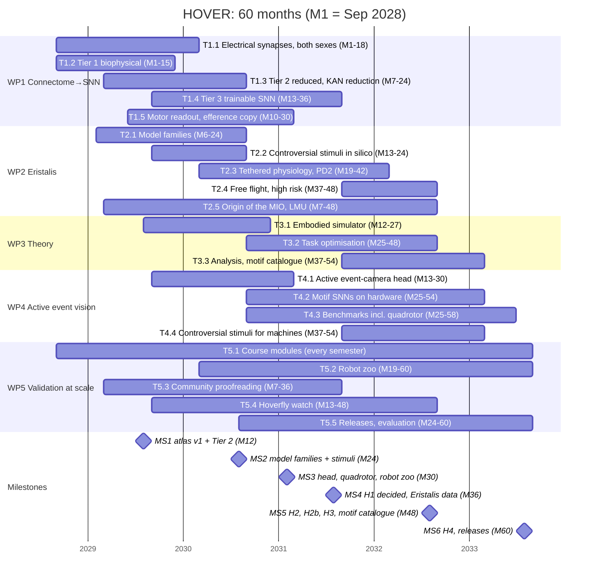

# Timeline

Planned start **1 Sep 2028** (placeholder). Final ERC results arrive 17 Dec 2027, followed by grant
preparation. M = project month; MS = milestone (see B2 §3). The rendered chart is
`proposal/figures/fig_B3_gantt.png` (Fig. B3), generated by `tools/make_gantt_svg.py`; keep the task
list there in sync with this file.

Team: PI (50 %); IU: Postdoc 1 (PD1, M1–48), PhD 1, PhD 2, research engineer (RE, M13–48), student
assistants; MPI-BI: Postdoc 2 (PD2, M7–42); LMU: PhD 3 (M7–54 funded for 48 PM).

